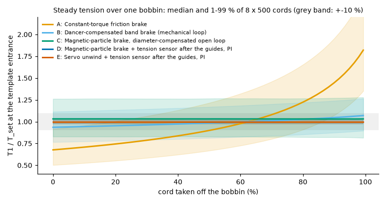
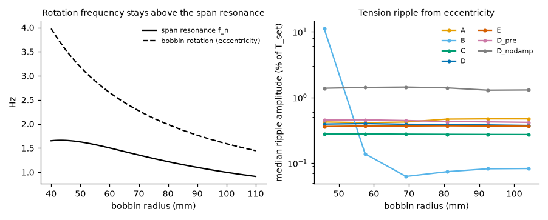
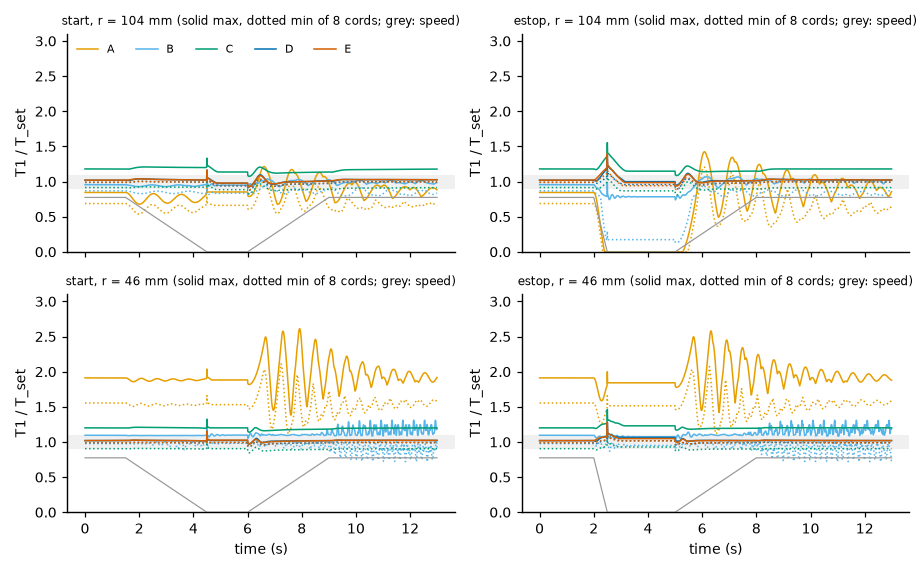
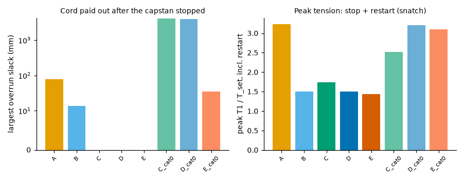
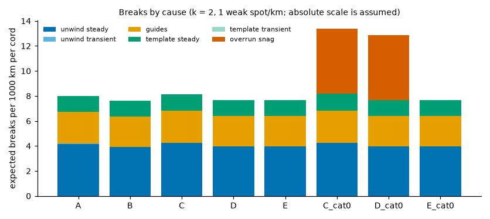
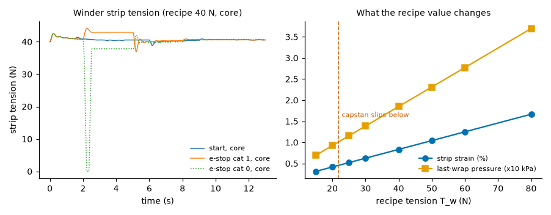
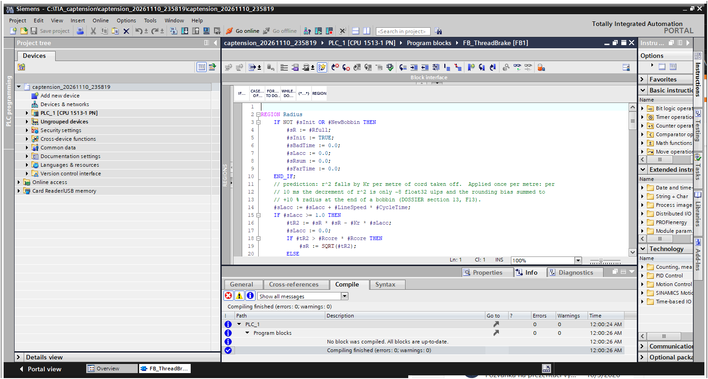

# Cap-strip cord tension: unwind-brake concepts, break causes and a PLC design

**Systems engineering dossier.** Pre-baseline draft, revision A, 11 Nov 2026.

This dossier answers a thesis topic published by a tyre plant: the analysis of the windup tension
regulation of a cap-strip line that unwinds 8 textile cords, rubberises them and winds the strip. It
follows C. S. Wasson, *System Engineering Analysis, Design, and Development* (2nd ed., Wiley 2016),
cited as **[W]** with the printed page and then the PDF page.

The engineering work is in this repository:
- the cord, bobbin, path, brake, winder and break models in `src/captension/`;
- the PLC code in `plc/` (four SCL function blocks, OB30, DBs);
- `scripts/run_study.py`, which writes `results/study.md` and `results/summary.json`;
- `scripts/aoa.py`, which writes `results/aoa.md`.

Every number below is reproduced by those scripts. Section 8.2 lists every parameter with its source
status (read / abstract / std / derived / assumed). Reading notes on Wasson are in `docs/sources/`.

> **Status.** Everything is simulation plus a TIA Portal V18 compile. No data from a real line has
> been used and no PLCSIM run was made. Open items that need the plant are in section 12.

**The engineering question.** Which unwind-brake concept keeps the tension of all 8 cords within
tolerance over a full bobbin and through start, stop and emergency stop, and what actually drives
thread breaks: the unwind, the guides or the rubberising template?

---

## 0. Summary of findings

Simulation: 500 machines x 8 cords quasi-statically over the bobbin; 32 machines x 8 cords dynamically
at 6 radii (steady running) and 3 radii (start, stop, emergency stop); the same machines and scenarios
for every alternative (paired). Tolerance: +-10 % of the recipe tension at the template entrance (an
assumed value, TBD-1). Alternatives (section 10.1): **A** constant-torque friction brake, **B**
dancer-compensated band brake, **C** magnetic-particle brake with diameter compensation (open loop),
**D** the same brake with a 3-roller tension sensor after the last guide and a PI, **E** servo unwind
with the same sensor.

1. **Over a full bobbin only the concepts that measure each cord after the guides stay in tolerance.**
   99th percentile of |T1/T_set - 1| in steady running (study section 3):

   | | A | B | C | D | E | D, sensor before the guides |
   |---|---|---|---|---|---|---|
   | p99 deviation | 89.9 % | 21.7 % | 27.6 % | **2.5 %** | **2.5 %** | 13.7 % |
   | cord length within +-10 % | 21.2 % | 76.9 % | 71.3 % | **100 %** | **100 %** | 91.6 % |
   | p99 pre-strain spread of the 8 cords at embedding | 2.08 % | 1.15 % | 1.22 % | **0.50 %** | **0.50 %** | 0.84 % |

   **Deciding parameters.** For A the radius ratio r_full/r_core = 2.75 (tension -32 % ... +88 % over the
   bobbin). For B, C and D-before-the-guides the guide-friction spread: sigma(mu) x wrap = 0.04 x 1.6 rad
   = **6.4 % of tension per position (1 sigma)**, which no bobbin-side controller can see. The brake type
   itself is secondary: what matters is *where* the tension is measured. For B also the mechanical loop
   gain beta: even the best of 2 / 4 / 10 (beta = 4) hunts near the core (24 % p99 ripple); a higher gain
   hunts more, a lower one droops.
2. **Through start, stop and emergency stop D and E stay closest, but no concept holds +-10 % at every
   instant** (study section 4, worst machine, category-1 stop):

   | | A | B | C | D | E |
   |---|---|---|---|---|---|
   | start: peak / lowest T1/T_set | 3.23 / 0.41 | 1.50 / 0.66 | 1.29 / 0.70 | **1.11 / 0.85** | 1.12 / 0.85 |
   | stop: peak / lowest | 2.45 / 0.37 | 1.41 / 0.74 | 1.45 / 0.74 | **1.20 / 0.93** | 1.20 / 0.92 |
   | e-stop incl. restart: peak / lowest | 3.23 / 0.00 | 1.50 / 0.00 | 1.74 / 0.71 | **1.50 / 0.86** | 1.43 / 0.87 |
   | e-stop overrun slack | 78 mm | 14 mm | 0 | 0 | 0 |

   A speed-damping term in the brake law (torque on the bobbin overspeed, scheduled as Kd r sqrt(J)) is
   what makes D work: the magnetic-particle brake has no speed-dependent torque and the span resonance
   (0.9-1.7 Hz) is lightly damped. Without it no PI setting held +-10 % through a start (best p99
   13.2 % vs 7.0 % with it; study section 10).
3. **The emergency-stop category decides more than the brake type.** If the electric brakes lose power
   at an emergency stop (category 0), the bobbins coast: **3.9-4.0 m of slack** per cord and a peak of
   **2.8-3.2 x** set at the restart (C, D). In category 1 (brakes powered until standstill) there is no
   slack. A servo with a holding brake (E, category 0) leaves 35 mm of slack but snaps to 3.1 x. The
   mechanical brakes keep braking without power, yet A still overruns 78 mm because its fixed torque
   cannot stop a full bobbin in 0.5 s.
4. **Breaks are decided by the steady tension at the template exit and by cord defects, not by the
   brake concept.** Sound cord does not break at these tensions (Weibull probability below 1e-20 over
   1000 km at 25 N). With weak spots of strength tail F(s) = (s/206 N)^k (k = 2, 1 per km, both assumed,
   absolute counts scale linearly with the density), the expected breaks per 1000 km per cord are
   A 8.02, B 7.64, C 8.16, **D 7.67**, E 7.66: the concept changes them by at most 6 % (18 % at k = 3).
   - **Where:** 100 % of the expected breaks occur between template and capstan, where the tension is
     highest (T2 = G T_b + D).
   - **From what (Euler allocation, D):** unwind 52 %, guides 31 %, template 17 % of that tension.
   - **What changes the count (levers, D):** halving the template drag **-16 %**, lowering the set
     tension by 10 % **-16 %**, polishing the guides **0 %** (the loop makes up for the friction; -1 % for
     A-C).
   - **Transients:** starts, stops and category-1 emergency stops add less than 0.1 %: they expose only
     the few metres of cord in the path. Category-0 stops add **+5.2 per 1000 km (+68 %)** through
     overrun loops that snag (assumed 30 % snag probability above 100 mm of slack).
5. **Direct measurement design.** A 3-roller head after the last guide (49 N range, +-1 % FS, 30 Hz
   [S1]), calibrated in place, gives **0.19 N (1.3 % of set) 1 sigma**; out of the box it is +-0.49 N
   (3.3 %). The model-based "virtual" tension from brake current, encoder and diameter estimate has a
   **p99 static error of 23 %** (brake gain, drag, guide spread are unobservable from current and
   speed): a plausibility check, not a substitute.
6. **Cost.** Eight positions with engineering: A 1.2, B 5.8, C 15.2, **D 32.2**, E 47.2 kEUR (sensor and
   servo prices assumed; brake list price read). **D does not pay back on breaks** against B, because it
   does not reduce them (finding 4); it buys tension accuracy and a 2.3 x smaller pre-strain spread.
   Trade study (section 10): D 70.6, E 65.0, B 58.4, C 52.1, A 39.9; no +-10 % weight change moves the
   winner; **B wins once cost carries a weight of 40 or more**. E adds nothing over D in category 1.
7. **Winder and recipe tension.** The pull-off capstan decouples the strip from the cords as long as it
   does not slip: with about 144 N entering, **T_w >= 21.8 N** (capstan law, mu = 0.6 assumed). At the
   assumed 40 N recipe the strip strain is 0.83 % and the pressure under the last wrap 18.5 kPa; both
   scale linearly with the recipe value. Through start and stop the winder holds 0.94-1.10 of the
   tapered reference; a category-1 emergency stop dips to 0.71, category 0 snatches to 2.78 x with 41 mm
   of slack.
8. **Fits the PLC.** All four blocks, the DBs and OB30 (cyclic interrupt, 10 ms) compile in TIA Portal
   V18 for a CPU 1513-1 PN with **0 errors and 0 warnings**. Worst-case execution **0.58 ms** per 10 ms
   cycle at data-sheet instruction times, **1.73 ms** with a 3x margin. The SCL runs in CI through a
   float32 translator against the Python twins. **float32 found a defect:** predicted from the consumed
   length alone, the radius ended a bobbin at 44.08 mm instead of 40.00 mm (+10 %), because each 10 ms
   decrement of r^2 is only 7 float32 ulps; applied once per metre it ends at 40.003 mm.
9. **Recommendation (section 10.3).** First install FB_DataCollect with the existing brakes and count
   breaks by phase and position for two weeks (it tests finding 4 on the line). Then convert one
   position to D with the sensor after the last guide, and run every electric unwind brake on a supply
   that survives a category-1 stop. Lower the break count through the template drag, the set tension
   and the cord's weak-spot density, not through the brake.

---

## 1. Problem and stakeholders  ([W] ch. 4-5)

### 1.1 Problem statement

Following the guidelines in [W] p.92/122 (one sentence, no cause, no solution, no blame):

> While the cap-strip line unwinds eight textile cords, rubberises them and winds the strip, the
> tension of individual cords leaves its recipe window over the bobbin and during start, stop and
> emergency stop, and cords break during production.

**Discussion** (kept apart from the statement, as [W] asks). The thesis topic is written partly as a
list of solutions: collect data, measure tension directly, compare mechanical and electrical brakes,
analyse the winding, count breaks. [W] warns that stakeholders state needs as solutions (p.103/133)
and recommends the Five Whys (p.104-105):

1. **Why compare brakes?** Because the cord tension is believed to depend on the brake type.
2. **Why does cord tension matter?** Two reasons: the cords are embedded in the rubber at whatever
   tension they have at the template (pre-strain spread = loose or wavy cords in the cap ply), and a
   cord breaks when the tension it meets exceeds the strength of its weakest spot.
3. **Why does tension vary?** Because the bobbin radius falls by a factor 2.75, the bobbin inertia by a
   factor 20, the guides multiply the tension by exp(mu * wrap) with a different mu at every position,
   and the template adds a drag of its own (section 8).
4. **Why does that decide the brake?** A brake can only act on the bobbin side of the path. Whether it
   controls the right quantity depends on *where the tension is measured*, not on the brake (finding 1).
5. **What decides the breaks?** The tension a weak spot meets, which is mostly the steady tension at the
   template exit, not the brake type (finding 4).

**This is why the topic's five tasks are one project.** The data collection (task 1) is how the plant
tests the break-cause hypothesis of this study; the direct measurement (task 2) is the part of the
"electrical brake" that does the work (task 3); and the winder (task 4) is decoupled from the cords by
the capstan, with one exception (section 8.6).

### 1.2 Stakeholders  ([W] Table 4.2, p.84-85/114-115)

| Role ([W] Table 4.2) | Who | What they need from this system |
|---|---|---|
| User / end user | line operator | Few breaks; quick re-threading; clear message *which* cord broke and why; no hand adjustment of brakes as bobbins empty |
| System owner | production / process engineering | Fewer breaks per 1000 km; strip within the recipe tension; data to argue the cause of breaks |
| Maintainer | automation / maintenance | Brakes and sensors that can be calibrated and checked; SCL they can read in TIA Portal |
| Customer's customer ([W] P4.3, p.78) | tyre building / cap-ply quality | Cords with equal pre-strain (no wavy cords); strip without stretch marks or loose spool layers |
| Supplier | cord supplier | Break data separated from machine causes (a weak-spot count per km is a supplier metric) |
| Developer | thesis student + supervisor | A verifiable design within the thesis |
| Independent test agent ([W] P13.15, p.289/319) | the plant's process engineer at the line trial | Acceptance against the MOEs, independent of the developer |

### 1.3 Needs, MOEs and MOPs  ([W] p.100-101/130-131, Fig. 5.8 p.116/146)

| ID | Need | MOE / MOS | Contributing MOPs (section 4) |
|---|---|---|---|
| N1 | Fewer thread breaks | MOE-1: breaks per 1000 km of cord, by cause | SPS-301, SPS-303, SPS-304, SPS-321 |
| N2 | Equal cord pre-strain in the strip | MOE-2: cord-to-cord strain spread at embedding | SPS-301, SPS-302 |
| N3 | Strip wound at the recipe tension | MOE-3: fraction of strip length outside +-10 % of the tapered recipe | SPS-331, SPS-332 |
| N4 | Know why a cord broke | MOE-4: share of breaks with a classified cause | SPS-321, SPS-322 |
| N5 | Nothing hard to maintain, no new hazards | MOS-1: closed-loop availability; MOS-2: calibration time per position | SPS-203, SPS-311, SPS-323 |

Each MOE has two or more MOPs ([W] p.438/468).

---

## 2. Concept of operations  ([W] ch. 6)

### 2.1 Mission and context

**What the line does.** Eight bobbins of nylon 6.6 tyre cord (1400 dtex x1x2, [M1]) sit in a creel.
Each cord runs through eyelets, a comb and deflection guides into a rubberising template (a crosshead
die fed by an extruder), where compound closes around the eight cords to form a strip. A pull-off
capstan sets the line speed; a winder winds the strip with a liner onto a spool at a recipe tension.

**What this system adds** (a PLC function set in TIA Portal on the line PLC):
1. Hold the tension of each cord at the template entrance at the recipe value (unwind brakes).
2. Hold the strip tension at the winder at the tapered recipe value.
3. Detect thread breaks, stop the line, capture the data around the break and classify it.
4. Measure each cord directly (3-roller sensor) and estimate it from the brake model as a cross-check.

**What it does not do.** It is not a safety function: emergency stop, guards and the safety relay stay as
they are. It does decide what the brakes do *during* an emergency stop, which matters (finding 3).

**Context** (interfaces in section 6): tension sensors (IF-01), brake amplifiers (IF-02), spindle encoders
(IF-03), HMI (IF-04), winder drive and strip load cell (IF-05), capstan drive and rubberising head
(IF-06), safety relay feedback (IF-07).

### 2.2 Phases and use cases  ([W] P5.7 p.110/140; UC principles p.120-122/150-152; Table 6.4 p.143/173)

| Phase | Use case (verb + outcome) | Trigger | Main success scenario | Alternate / failure scenarios |
|---|---|---|---|---|
| Pre-mission | **UC1** Thread up the line | Operator selects Jog | Brakes open loop at jog speed; cords pulled through guides and template | A cord slips out of a guide: tension low, operator re-threads |
| Pre-mission | **UC2** Calibrate a tension sensor | New sensor, yearly, or a plausibility alarm | Two-point check with a reference weight in place; offset and gain stored | Virtual tension and sensor disagree by > 10 %: sensor or brake suspect |
| Mission | **UC3** Start the line | Operator Start | Ramp to line speed; every cord inside +-10 % | Breakaway / inertia peak; slack left from an e-stop is taken up (snatch) |
| Mission | **UC4** Run a bobbin set | Continuous | Diameter estimate follows each bobbin; tension held from full to core | Eccentric package excites the span resonance; a sensor fails: that position runs open loop |
| Mission | **UC5** Change a bobbin | Bobbin empty (radius at core) | Stop, change, NewBobbin pressed, start | NewBobbin forgotten: diameter estimate re-seeds from v/omega (section 8.4.4) |
| Mission | **UC6** Handle a thread break | Tension < 20 % of set for 50 ms, or a drop-wire switch | Line stops on the normal ramp; 3 s of data frozen; cause classified and counted | Break during an e-stop restart: slack is not reported as a break |
| Mission | **UC7** Emergency stop | Safety relay opens | Line quick stop 0.5 s; brakes decelerate the bobbins with the line; hold | Category-0 stop: brakes lose power, bobbins overrun, slack metres of cord |
| Post-mission | **UC8** Analyse breaks | Shift end / weekly | Counters per cause and per position read from the DB; captures exported | One position far above the others: inspect its guides |

**Coverage check** ([W] Fig. 6.3, p.137-138; Author's Note 6.1, p.137/167): pre-mission UC1-UC2,
mission UC3-UC7 including degraded (sensor fault) and emergency (UC7) operations, post-mission UC8.

---

## 3. Modes and states  ([W] ch. 7)

A **mode** is a user-selectable label that enables capabilities; a **state** is an observable,
measurable condition ([W] p.148-149/178-179).

**Table 3-1: line modes** (FB_LineSupervisor). Exit criteria per [W] Author's Note 7.4.

| # | Mode | Brake mode | Winder | Exit criteria |
|---|---|---|---|---|
| 0 | Idle | 3 Hold | Hold | Start -> 2; Jog -> 1 |
| 1 | Jog | 1 OpenLoop | Run | Jog released -> 4 |
| 2 | RampUp | 2 Closed (1 without sensors) | Run + PI | Speed = Vset -> 3; Stop -> 4; break -> 4; e-stop -> 5 |
| 3 | Run | 2 Closed (1) | Run + PI | Stop or break -> 4; e-stop -> 5 |
| 4 | RampDown | 2 Closed (1) | Run + PI | Speed 0 -> 0 (or 6 after a break) |
| 5 | EStop | 4 EStop -> 3 Hold at standstill | EStop | Safety relay closed **and** Ack -> 0 |
| 6 | Fault (after a break) | 3 Hold | Hold | Ack -> 0 |

**Brake modes** (FB_ThreadBrake): 0 Off, 1 OpenLoop (diameter-compensated torque with inertia
feedforward and speed damping), 2 Closed (plus tension PI; falls back to 1 on a sensor fault, keeping
the learned integral), 3 Hold, 4 EStop (feedforward on the known quick-stop deceleration).

**State variables** ([W] P7.2-7.3, p.154-156): operational state (mode, break latch, BreakThread);
dynamic state ([W] P7.9, p.166/196): bobbin radius estimate and its plausibility timer, slack length
after an e-stop, the frozen capture of FB_DataCollect.

**Allowable and prohibited actions** ([W] P7.10 p.169/199): break detection is prohibited while the
slack estimate of that position is above zero (the cord is known to be slack); restart after an e-stop
requires Ack; all mode changes of FB_ThreadBrake are bumpless (integral tracking, `tests/test_scl.py`).

---

## 4. Requirements  ([W] ch. 19-22)

Outline after [W] Table 20.1 (p.417-418/447-448); the global requirement of [W] P22.2 (p.448) applies.
Statements follow [W] P22.5 (p.449), one capability and one outcome each (P22.9, p.451), with Threshold
and Objective values ([W] p.410/440) and a verification method I/A/D/T ([W] p.270-272).

**Provisional values (P).** The recipe tension, its tolerance and the pre-strain limit are not known
(TBD-1). Each (P) value names the analysis it rests on ([W] P19.14, p.402/432), and [W] p.426/456 warns
that a value backed by no analysis is not a requirement.

### 4.1 Missions and operational performance (spec. section 3.1-3.2)

| ID | Requirement | Threshold | Objective | Verif. | Trace |
|---|---|---|---|---|---|
| SPS-201 | With the new functions, thread breaks per 1000 km of cord shall not exceed the current value. | <= baseline | <= 0.8 x baseline | T (VAL-1) | MOE-1 |
| SPS-202 | Strip spools with winding defects (loose layers, telescoping) shall not exceed the current rate. | <= baseline | - | T (VAL-1) | MOE-3 |
| SPS-203 | Closed-loop tension control shall be available for the stated fraction of production time per position. | >= 99 % | >= 99.8 % | A + T | MOS-1 |

### 4.2 Capabilities (section 3.3)

| ID | Requirement | Threshold | Objective | Verif. | Trace |
|---|---|---|---|---|---|
| SPS-301 | In production from full bobbin to core, the tension of each cord at the template entrance shall be within the tolerance of the recipe value over the stated fraction of cord length. | +-10 % over >= 99 % (P) | +-5 % over >= 99 % (P) | A (section 8.3) + T | N1, N2 |
| SPS-302 | The 99th percentile of the cord-to-cord strain spread at embedding shall not exceed the stated value. | 1.0 % (P) | 0.5 % (P) | A + T | N2 |
| SPS-303 | Through a normal start and stop the tension of each cord at the template entrance shall stay within the stated band. | 0.8 ... 1.25 x set | 0.9 ... 1.1 x set | A + T | N1 |
| SPS-304 | In an emergency stop with restart, no cord shall go slack by more than the stated length, and the peak tension shall not exceed the stated value. | 10 mm; 1.5 x set | 0 mm; 1.3 x set | A + T | N1 |
| SPS-305 | After a bobbin change without the NewBobbin signal, a cord shall be slack for no longer than 0.2 s and shall return within +-10 % of its steady value within 5 s. | 0.2 s; 5 s | 0 s; 2 s | A + T | N1, N5 |
| SPS-311 | The system shall measure the tension of every cord continuously with the stated uncertainty and bandwidth. | 2 % of set (1 sigma), >= 10 Hz | 1 %, >= 30 Hz | A + T | N2, N4 |
| SPS-312 | The system shall compute a model-based tension for every position and report it with the measured one. | reported | - | I | N4, N5 |
| SPS-321 | The system shall detect a thread break within the stated time and stop the line on the normal ramp. | 100 ms | 50 ms | T | N4 |
| SPS-322 | For every detected break the system shall freeze at least 2 s before and 1 s after it of all cord tensions, brake currents, strip tension, winder torque, line speed and mode, classify the cause, and count breaks per cause and per position. | as stated | - | T | N4 |
| SPS-323 | On a tension-sensor fault the position shall continue in open loop without a torque step larger than the stated value. | 5 % | 1 % | T | N5 |
| SPS-331 | Through start and stop the strip tension shall stay within the stated band of the tapered recipe value. | +-10 % | +-5 % | A + T | N3 |
| SPS-332 | The recipe strip tension shall keep the pull-off capstan from slipping. | T_w >= T_in exp(-mu theta) | x 1.5 margin | A | N3 |

### 4.3 Interfaces, environment, constraints (sections 3.4-3.6)

External interfaces only ([W] p.420/450), detailed in section 6. Operating range: line speed 0.5-2 m/s,
recipe tension 8-25 N per cord, cord 1400 dtex x1x2 nylon 6.6, bobbins 40-110 mm (TBD-2, TBD-5).

| ID | Constraint | Verif. |
|---|---|---|
| SPS-361 | The functions shall run in a cyclic-interrupt OB at 10 ms on an S7-1513-class CPU with a worst-case execution of at most 3 ms including the margin of section 7.1. | A + T (cycle statistics) |
| SPS-362 | The code shall be SCL in TIA Portal V18 and compile with 0 errors and 0 warnings; no third-party libraries. | I + T |
| SPS-363 | New field hardware shall be limited to one tension sensor, one brake amplifier and one encoder per position (IF-01...IF-03). | I |

---

## 5. Architecture  ([W] ch. 26)

[W] p.551-552/581-582 uses four views: requirements, operations, behavioural and physical. The
behavioural view plays the role of a "logical architecture" (not Wasson's term).

**Behavioural view** (capabilities, [W] P26.15 p.559/589):

```
 IF-03 omega_i ---> [B1 Estimate bobbin radius i] --r_i, J_i--+
                                                              v
 IF-01 T_i -------> [B2 Regulate cord tension i] <---- a, v (B4 ramp)
                         | brake current (IF-02)            ^
                         v                                  |
                    [B3 Estimate virtual tension i] --------+--> HMI, plausibility
 IF-05 T_strip ---> [B5 Regulate strip tension] --> winder torque (IF-05)
 IF-04/IF-07 -----> [B4 Supervise: modes, ramp, break + slack detection] --> capstan speed (IF-06)
                         | trigger, thread, phase
                         v
 all signals ------> [B6 Collect, capture, classify, count] --> DB / OPC UA
```

**Physical view.** One capability to one SCL block, so every leaf requirement is allocated to one
entity ([W] P21.2, p.437/467):

| Capability | SCL block | Requirements allocated |
|---|---|---|
| B1, B2, B3 | `FB_ThreadBrake` (x8) | SPS-301...305, SPS-312, SPS-323 |
| B5 | `FB_WinderTension` | SPS-331 |
| B4 | `FB_LineSupervisor` | SPS-304, SPS-321 |
| B6 | `FB_DataCollect` | SPS-322 |
| Wiring | OB30 `Cyclic_CapStrip` (10 ms) + `LineIO` + instance DBs | SPS-361...363 |

**Hardware.** Reference CPU 1513-1 PN (6ES7 513-1AL02-0AB0, FW 2.9); per position a 3-roller tension
sensor after the last guide, a magnetic-particle brake with a current amplifier and an encoder on the
spindle (alternative D, the recommendation of section 10).

**Fault isolation** ([W] P26.16, p.559-560/589-590): a sensor fault removes only that position's PI
(open loop with the learned correction); a wrong diameter estimate is contained by the plausibility
gate and the re-seed; the slack estimate keeps a slack cord from being reported as broken. The
emergency stop stays in the safety relay; the brake amplifiers need a supply that survives the
category-1 stop (finding 3).

---

## 6. Interfaces  ([W] ch. 27)

The line PLC owns all interfaces ([W] P27.3, p.577/607); one system ICD as [W] p.582 advises for small
projects; mnemonics after [W] P27.6 (p.583).

| ID | Source -> destination | Signal | Type / range | Rate | Integrity / fault handling |
|---|---|---|---|---|---|
| IF-01 | 3-roller sensor i -> AI -> PLC | Cord tension after the last guide | 0-10 V or 4-20 mA, 0-49 N [S1] | every OB30 call | channel status + range -> TensionOk; virtual tension as cross-check |
| IF-02 | PLC -> brake amplifier i | Current set point | 0-1 of full scale (0..Imax) | 10 ms | amplifier ready bit (TBD-7); supply must hold during a category-1 stop |
| IF-03 | Spindle encoder i -> PLC | Bobbin speed | 2048 ppr x4 (assumed) | 10 ms | v/omega plausibility gate, re-seed |
| IF-04 | HMI <-> PLC | Start/Stop/Jog/Ack, recipe Tset and Trecipe, NewBobbin, Release; modes, radii, virtual tensions, counters | Bool/Real/Int | HMI cycle | - |
| IF-05 | Winder drive <-> PLC; load cell -> PLC | Torque set point; spool speed; strip tension | N m; rad/s; 0-200 N | 10 ms | telegram valid; load-cell status |
| IF-06 | PLC -> capstan drive; head -> PLC | Speed reference; die pressure and compound temperature | m/s; bar; degC | 10 ms | used only for classification |
| IF-07 | Safety relay -> PLC | EStopOk feedback | Bool | 10 ms | the safety function itself is outside this system |

**Timing** (step 7 of [W] p.583/613): one OB30 call reads every input and writes every output. The
sensor's 30 Hz filter [S1], the brake's 25 ms lag [B2] and the 10 ms period sit inside the loop and are
in the simulation.

---

## 7. Performance budgets and margins  ([W] ch. 31)

### 7.1 PLC cycle-time budget  ([W] P31.4 apportionment, p.668; section 31.4 frame-based systems, p.679/709)

**Why 10 ms.** The span resonance is 0.9-1.7 Hz and the brake lag 25 ms [B2]; the tension loop crosses
over near 1 Hz. A 10 ms period adds 10 ms of sampling delay plus 5 ms of hold, about 5 degrees of phase
at 1 Hz, and samples the 30 Hz sensor at 3.3x its bandwidth. It also gives the break detector a 50 ms
confirmation in 5 samples (SPS-321). 100 ms (as in many process loops) would cost 54 degrees at 1 Hz;
1 ms buys nothing the brake can use.

Operations come from running the SCL through the translator with counters; costs from the CPU 1513-1 PN
data sheet [P1]: 256 ns per floating-point operation, 64 ns per fixed-point operation, 48 ns per move;
SQRT costed as 20 floating-point operations (assumed).

| Allocation in the 10 ms OB30 frame | Estimate | Allocated (x3 margin, [W] p.669) |
|---|---|---|
| FB_ThreadBrake x 8 (closed loop, moving: 88 Real ops, 1 SQRT, 40 moves each) | 237 us | 0.71 ms |
| FB_WinderTension | 19 us | 0.06 ms |
| FB_LineSupervisor (loop over 8) | 9 us | 0.03 ms |
| FB_DataCollect recording (20 channels) | 5 us | 0.01 ms |
| FB_DataCollect classification cycle (200-slot scan, once per break) | 280 us | 0.84 ms |
| Call overhead 12 x 2 us (assumed) + array parameters | 29 us | 0.09 ms |
| **Worst cycle** | **0.578 ms** | **1.73 ms <= 3 ms (SPS-361)** |
| Reserve at system level ([W] Fig. 31.1, p.670/700) | | >= 7 ms for the rest of the line program |

The margin covers indexed access into optimized DBs and call overheads that the data sheet does not
list. Verification: CPU cycle statistics during the trial (VT-07); the prediction is a TPM ([W] P21.4,
p.442/472).

### 7.2 Tension error budget at the template entrance (alternative D)  ([W] P31.5, p.669/699)

| Contributor | Size | Basis |
|---|---|---|
| Sensor chain after in-situ calibration (table 7.3) | 0.19 N = 1.3 % 1 sigma | section 7.3 |
| Brake gain, drag and hysteresis spread | removed by the PI (integral) | study section 3 |
| Guide friction spread (6.4 % 1 sigma) | removed: the sensor sits after the last guide | D vs D_pre, study section 3 |
| Template drag spread (15 % of 2.97 N) | not removed: acts after the sensor; enters the pre-strain spread | study section 2 |
| Ripple from package eccentricity | 0.6 % p99 amplitude | study section 3 |
| **Result in simulation** | **p99 2.5 %, all cords within +-10 % for 100 % of the length** | study section 3 |

### 7.3 Measurement chain  (study section 12)

| Contribution | 1 sigma | of T_set |
|---|---|---|
| Out of the box, +-1 % FS of a 49 N head [S1] | 0.28 N | 1.9 % |
| After two-point calibration with a reference weight (+-0.3 % FS, assumed procedure) | 0.085 N | 0.6 % |
| Temperature drift 0.1 % FS/K [S1] over +-5 K (assumed) | 0.14 N | 0.9 % |
| Noise 0.2 % FS (assumed) | 0.10 N | 0.7 % |
| Analog input +-0.1 % FS (assumed) | 0.03 N | 0.2 % |
| **Calibrated chain (root sum of squares)** | **0.19 N** | **1.3 %** (SPS-311: 2 %) |

Range: the highest category-1 tension at the sensor is 22.6 N against a 49 N range; resolution
1.8 mN per count. A 1 mm path offset on a 10 mm deflection changes the head gain F/T = 2 sin(theta/2)
by 5.5 %, which is why the calibration is done in place.

### 7.4 Brake sizing

| Quantity | Value | Basis |
|---|---|---|
| Steady torque, full bobbin (9.28 N x 0.110 m) | 1.02 N m | derived |
| Emergency stop, full bobbin: + J a / r = 0.0322 x 2 / 0.110 | +0.59 N m -> 1.59 N m | derived |
| Steady torque at the core (9.28 N x 0.040 m) | 0.37 N m | derived |
| Brake rating (B35 class) | 3.95 N m: margin 2.5x on the e-stop torque | [B2] |
| Residual drag (1 % of rating, assumed) | 0.04 N m = 11 % of the core torque | the reason the drag must be inside the loop (D), not ignored (C) |

---

## 8. Modelling and simulation  ([W] ch. 33)

### 8.1 Intended use, model and fidelity  ([W] P33.1 p.706/736; fidelity matrix p.708/738)

**Intended use.** (1) Compare the five unwind concepts under the same machines and scenarios
(paired); (2) attribute expected breaks to their causes and find the levers; (3) size the sensor,
the brake and the PLC budget; (4) produce provisional MOP values. The model is **not** accredited to
predict absolute tensions or break counts on the plant's line ([W] p.704: accreditation is for a
purpose). It needs the line data of VT-01...VT-03 first ([W] P33.4, p.716/746).

**Equations** (code: `src/captension/`).

1. *Bobbin* (`bobbin.py`). Package volume balance r^2 = r_full^2 - A_c L / (pi w phi) with
   A_c = (linear density)/(fibre density); hollow-cylinder inertia
   J(r) = J_core + (pi/2) rho phi w (r^4 - r_core^4); torque balance
   J dw/dt + (dJ/dt) w = T_b r - M_brake - M_bear, with the radius and inertia time-varying as in
   [K2] eq. 3 ("both inertia J_k and radius R_k ... vary substantially"); v_b = w (r + e sin theta)
   for an eccentric package.
2. *Cord path* (`sim.span_rate`). Three free segments: L0 bobbin -> guides (plus the dancer loop in B),
   L1 guides -> template, L2 template -> capstan. Tensions T_b, T1 = G T_b, T2 = T1 + D. Conservation
   of unstretched cord: U = L0'/(1+e_b) + L1/(1+e_1) + L2/(1+e_2), dU/dt = v_b - v_c/(1+e_2) (relaxed
   package, as T_0 = 0 in [K1]), hence
   dT_b/dt = [v_b - v_c/(1+e_2) - (dL0'/dt)/(1+e_b) - (dU/dD) dD/dt] / (dU/dT_b).
   For one segment this is [K2] eq. 2, L dT/dt = EA (v2 - v1) + T1 v1 - T v2, to first order in the
   strain (test `test_span_rate_reduces_to_koc_equation_for_one_segment`). Kelvin-Voigt damping
   T = T_e + tau_d dT_e/dt with tau_d = tan(delta)/omega_ref. Negative tension -> slack length
   integrated instead; taking it up again is the snatch.
3. *Guides* (`params.guide_factor`). Capstan law T_out = T_in exp(mu theta) [T3] over the total wrap,
   with mu different at each position ([F1]-[F3]: mu depends on material, speed and tension, so it
   carries a spread).
4. *Template* (`params.die_drag`). Wire-coating analogue [R3]: shear stress at the cord surface
   tau = s k exp(-b (T - T0)) (v/h)^n with the compound of [R1] (k = 0.9881e6 Pa s^n, n = 0.2226,
   b = 0.0089 /K, T0 = 363 K) and a wall-slip factor s [R2], over the wetted land:
   D = tau pi d L_land. With n = 0.22 the drag hardly depends on speed: 1.78 N at 0.1 m/s,
   2.97 N at 1 m/s. A restart overshoot (rested compound) of 1.5x decaying over 0.3 m of travel.
5. *Brakes* (`sim.simulate`). A: constant kinetic torque, static 1.3x (breakaway). B: dancer arm
   I_a phi'' = 2 T_b l_a - K_s (phi0 + phi) - c_a phi', band torque M = C_b (phi_c - phi), path length
   L0' = L0 - 2 l_a phi, band stiction 1.3x. C/D: magnetic-particle brake M = K (1 + dK) I + drag + hyst
   through a 25 ms lag [B2], static = kinetic. E: servo torque, 2 ms lag, bidirectional; in category 0
   the STO removes torque and a holding brake engages after 50 ms.
6. *PLC* (`control.ThreadBrakeVec` = FB_ThreadBrake): every 10 ms, quantised encoder, 3-roller sensor
   with a 30 Hz filter, offset and noise.
7. *Winder* (`winder.py`): one strip span leaving the non-slipping capstan with the upstream strain
   ([K2] eq. 2 with T_k-1 = upstream), spool J_w(R), drive lag 5 ms, FB_WinderTension.
8. *Breaks* (`breaks.py`, section 8.5).

| Phenomenon | Fidelity | Basis |
|---|---|---|
| Cord elasticity | linear EA = 600 N in 0-40 N; Kelvin-Voigt damping | [M1] load-elongation points; tan(delta) assumed |
| Cord strength | Weibull for sound cord; power-law tail for weak spots | [M1] minimum; distribution assumed (TBD-6) |
| Bobbin | exact geometry, eccentricity at rotation frequency | geometry std; values assumed (TBD-5) |
| Span dynamics | conservation of cord, 3 segments, slack | [K1], [K2] |
| Guides | capstan law, position spread, no wear | [T3], [F1]-[F3] |
| Template | power-law drag with slip, restart overshoot | [R1]-[R3]; slip, land, gap assumed |
| Brakes | stiction, lag, drag, hysteresis, gain spread | [B1]-[B3]; spreads assumed |
| Sensor | 30 Hz filter, offset, drift, noise | [S1] |
| Winder | single span, spool inertia, drive lag | std; values assumed |
| Abrasion of cords on guides, fluff, cord twist, air drag, temperature of the brakes over a shift, compound flow transients in the head | **not modelled** | known gaps (section 13) |

### 8.2 Sourced vs assumed parameters

All parameters, generated from `captension.params` (the code and this table cannot drift apart):

| Parameter | Value | Unit | Status | Source / note | Sensitivity range |
|---|---|---|---|---|---|
| `cord_break_min` | 206 | N | **read** | [M1] cord-fabric table, 1400 dtex x1x2 PA66; minimum breaking strength |  |
| `cord_elong_break` | 0.22 | - | **read** | [M1]; 22 +- 2 % |  |
| `cord_elong_20N` | 0.035 | - | **read** | [M1]; elongation at 20 N, 3.5 +- 1.5 % |  |
| `cord_elong_39N` | 0.065 | - | **read** | [M1]; elongation at 39 N, 6.5 +- 1.5 % |  |
| `cord_dia` | 0.00063 | m | **read** | [M1]; thickness 0.63 +- 0.03 mm, used as cord diameter |  |
| `EA` | 600 | N | **derived** | [M1] 20 N/3.5 % = 571 N secant, (39-20)/(6.5-3.5 %) = 633 N tangent; load-elongation slope used in 0-40 N |  |
| `EA_cv` | 0.03 | - | **assumed** | cord-to-cord, from the +-1.5 % elongation tolerance band | 0.01 - 0.06 |
| `cord_lin_density` | 0.0003 | kg/m | **assumed** | 2 x 1400 dtex = 0.28 g/m greige + ~7 % dip pick-up |  |
| `fibre_density` | 1140 | kg/m3 | **std** | [T1] PA66 fibre density 1.14 g/cm3 |  |
| `tan_delta` | 0.07 | - | **assumed** | cord loss factor near 2 Hz (Kelvin-Voigt damping) | 0.03 - 0.12 |
| `strength_mean` | 230 | N | **assumed** | mean > 206 N minimum; with CV 4 % the minimum is mean - 2.9 sigma |  |
| `weibull_m` | 30 | - | **derived** | m ~ 1.2/CV for CV 4 % (assumed CV); sound-cord strength | 15 - 40 |
| `weibull_L0` | 0.25 | m | **std** | [T2] ASTM D885 tensile test gauge length 250 mm (order) |  |
| `ws_density` | 1 | 1/km | **assumed** | weak spots per km of cord; scales all break counts linearly (TBD-6) | 0.1 - 10 |
| `ws_tail_k` | 2 | - | **assumed** | F_ws(s) = (s/S_ref)^k lower tail of weak-spot strength | 1 - 4 |
| `ws_Sref` | 206 | N | **derived** | = cord_break_min; tail reference strength |  |
| `r_core` | 0.04 | m | **assumed** | bobbin core radius |  |
| `r_full` | 0.11 | m | **assumed** | full bobbin radius |  |
| `bobbin_w` | 0.2 | m | **assumed** | traverse width |  |
| `pack_fill` | 0.6 | - | **assumed** | volume fill of the package | 0.5 - 0.7 |
| `J_core` | 0.0013 | kg m2 | **assumed** | core tube + spindle + brake rotor |  |
| `M_bear` | 0.02 | N m | **assumed** | bearing and seal drag of the spindle | 0.005 - 0.05 |
| `M_bear_cv` | 0.3 | - | **assumed** | bearing drag spread between positions |  |
| `ecc` | 0.0002 | m | **assumed** | package eccentricity (run-out) amplitude | 5e-05 - 0.0005 |
| `v_line` | 1 | m/s | **assumed** | line speed 60 m/min (TBD-2) | 0.5 - 2 |
| `t_ramp` | 3 | s | **assumed** | start/stop ramp 0 <-> full speed | 1 - 6 |
| `t_estop` | 0.5 | s | **assumed** | line quick-stop time in an emergency stop | 0.2 - 1.5 |
| `L0` | 2 | m | **assumed** | bobbin -> first guide (creel span) |  |
| `L1` | 1 | m | **assumed** | last guide -> template |  |
| `L2` | 2 | m | **assumed** | template -> pull-off capstan |  |
| `wrap` | 1.6 | rad | **assumed** | total wrap on fixed guides, eyelets and comb (sum of angles) | 0.8 - 3 |
| `mu_guide` | 0.3 | - | **abstract** | [F1] PP on ceramic 0.32-0.42; [F2] nylon on nylon 0.40-0.47; value assumed in that band | 0.2 - 0.45 |
| `mu_guide_sd` | 0.04 | - | **assumed** | position-to-position spread (wear, finish, contamination) | 0.01 - 0.08 |
| `T_set` | 15 | N | **assumed** | recipe tension per cord at the template entrance (TBD-1) | 8 - 25 |
| `tol` | 0.1 | - | **assumed** | tension tolerance +-10 % of set (TBD-1) |  |
| `rheo_k` | 988100 | Pa s^n | **read** | [R1] Ha et al. 2007, compound w6043, Table 1 (units assumed SI) |  |
| `rheo_n` | 0.2226 | - | **read** | [R1] |  |
| `rheo_b` | 0.0089 | 1/K | **read** | [R1]; temperature coefficient, reference 363 K |  |
| `die_T` | 363 | K | **assumed** | compound temperature in the template = reference temperature |  |
| `die_land` | 0.005 | m | **assumed** | wetted land length per cord | 0.002 - 0.01 |
| `die_gap` | 0.0003 | m | **assumed** | radial gap cord to template bore | 0.00015 - 0.0005 |
| `slip` | 0.05 | - | **assumed** | [R2] wall slip of filled rubber; fraction of no-slip shear stress transmitted | 0.02 - 0.15 |
| `die_cv` | 0.15 | - | **assumed** | cord-to-cord drag spread (bore wear, eccentricity) | 0.05 - 0.3 |
| `die_overshoot` | 1.5 | - | **assumed** | drag overshoot at restart (rested compound, stress overshoot) | 1 - 2.5 |
| `die_os_len` | 0.3 | m | **assumed** | cord travel over which the restart overshoot decays |  |
| `A_mu_cv` | 0.12 | - | **assumed** | torque spread between positions (lining, spring setting, temperature) | 0.05 - 0.25 |
| `mu_s_over_k` | 1.3 | - | **assumed** | [B1] static > kinetic friction of brake linings | 1.1 - 1.5 |
| `B_beta` | 4 | - | **assumed** | mechanical loop gain of the compensator at full bobbin (chosen from 2/4/10, study section 10) | 2 - 10 |
| `B_arm` | 0.15 | m | **assumed** | dancer arm length |  |
| `B_Ks` | 2 | N m/rad | **assumed** | dancer spring rate |  |
| `B_Ia` | 0.01 | kg m2 | **assumed** | dancer arm + roller inertia |  |
| `B_ca` | 0.02 | N m s/rad | **assumed** | dancer damping (pivot friction; chosen from 0.02/0.05/0.15, study section 10) |  |
| `B_preload_cv` | 0.03 | - | **assumed** | spring preload setting spread between positions | 0.01 - 0.06 |
| `B_band_mu_cv` | 0.12 | - | **assumed** | band friction spread | 0.05 - 0.25 |
| `B_travel` | 0.4 | rad | **assumed** | dancer travel either side of centre |  |
| `MPB_Mmax` | 3.95 | N m | **read** | [B2] magnetic-particle brake B35 class, 0.07-3.95 N m |  |
| `MPB_tau` | 0.025 | s | **abstract** | [B2] data-sheet response 'unforced 25' (units ms inferred) | 0.014 - 0.06 |
| `MPB_drag` | 0.01 | - | **assumed** | [B3] hysteresis brake drag ~0.5 % of rating (abstract); residual drag, fraction of rating | 0.003 - 0.03 |
| `MPB_hyst` | 0.01 | - | **assumed** | [B2] 'brakes exhibit hysteresis' (no figure); torque hysteresis, fraction of rating | 0 - 0.03 |
| `MPB_gain_cv` | 0.06 | - | **assumed** | torque-per-ampere spread unit-to-unit and with temperature | 0.02 - 0.12 |
| `enc_counts` | 8192 | 1/rev | **assumed** | spindle encoder 2048 ppr x4 |  |
| `E_tau` | 0.002 | s | **assumed** | torque loop of a servo drive |  |
| `E_gain_cv` | 0.02 | - | **assumed** | torque accuracy of a servo drive |  |
| `E_hold_M` | 3 | N m | **assumed** | motor holding brake applied at STO (category 0) |  |
| `E_hold_delay` | 0.05 | s | **assumed** | holding-brake engage delay |  |
| `sens_range` | 49 | N | **read** | [S1] 3-roller sensor, ranges 1-50 kg; 5 kg range |  |
| `sens_acc_fs` | 0.01 | - | **read** | [S1] accuracy +-1 % FS; out of the box |  |
| `sens_cal_fs` | 0.003 | - | **assumed** | after in-situ two-point calibration with a reference weight |  |
| `sens_drift` | 0.001 | 1/K | **read** | [S1] < +-0.1 % FS per degC |  |
| `sens_dT` | 5 | K | **assumed** | temperature swing at the creel after calibration |  |
| `sens_bw` | 30 | Hz | **read** | [S1] damping 30 Hz |  |
| `sens_noise` | 0.002 | - | **assumed** | noise RMS, fraction of FS |  |
| `sens_spacing` | 0.1 | m | **read** | [S1] outer roller spacing 100 mm up to 10 kg |  |
| `sens_defl` | 0.0005 | m | **read** | [S1] measuring-roller deflection max 0.5 mm |  |
| `shift_h` | 8 | h | **assumed** | shift length |  |
| `stops_per_shift` | 6 | 1/shift | **assumed** | normal stops incl. bobbin changes (TBD-3) | 2 - 15 |
| `estops_per_shift` | 0.5 | 1/shift | **assumed** | emergency stops (TBD-3) | 0.1 - 3 |
| `snag_len` | 0.1 | m | **assumed** | overrun slack above which a loop can catch a guide or a neighbour | 0.05 - 0.3 |
| `snag_p` | 0.3 | - | **assumed** | probability that such a loop snags and breaks the cord at restart | 0.1 - 0.8 |
| `hours_per_year` | 5000 | h | **assumed** | production hours per year |  |
| `cost_break` | 25 | EUR | **assumed** | re-threading stop (3 min) + scrap strip per break | 10 - 100 |
| `cost_A` | 150 | EUR | **assumed** | friction brake + weight/spring per position |  |
| `cost_B` | 600 | EUR | **assumed** | dancer compensator with band brake per position |  |
| `cost_C` | 1150 | EUR | **derived** | [B4] MPB15 list price USD 600 (read); 4 N m size + amplifier 250 + encoder 120 + I/O 80 (assumed) |  |
| `cost_D` | 3030 | EUR | **assumed** | C + 3-roller sensor 1800 (quote only, assumed) + I/O 80 | 2000 - 4500 |
| `cost_E` | 4400 | EUR | **assumed** | servo motor/gearbox/drive 2500 + sensor 1800 + I/O 100 |  |
| `eng_A` | 0 | EUR | **assumed** | one-off engineering for 8 positions |  |
| `eng_B` | 1000 | EUR | **assumed** |  |  |
| `eng_C` | 6000 | EUR | **assumed** |  |  |
| `eng_D` | 8000 | EUR | **assumed** |  |  |
| `eng_E` | 12000 | EUR | **assumed** |  |  |
| `Ts` | 0.01 | s | **assumed** | OB30 period (justified in DOSSIER section 7.1) |  |
| `W_T` | 40 | N | **assumed** | recipe strip tension at the winder (TBD-1) | 20 - 80 |
| `W_taper` | 0.2 | - | **assumed** | hyperbolic taper over the spool |  |
| `W_rcore` | 0.1 | m | **assumed** | spool core radius |  |
| `W_rfull` | 0.166 | m | **derived** | 1000 m of 12 x 1.1 mm strip+liner on a 0.3 m traverse, fill 0.8 |  |
| `W_Jcore` | 0.1 | kg m2 | **assumed** | spool core + shaft |  |
| `W_strip_mass` | 0.016 | kg/m | **derived** | 8 cords x 0.30 g/m + 12 x 1.0 mm x 1150 kg/m3 compound |  |
| `W_strip_w` | 0.012 | m | **assumed** | strip width |  |
| `W_layer` | 0.0011 | m | **assumed** | strip + liner thickness per layer |  |
| `W_span` | 3 | m | **assumed** | capstan -> winder span |  |
| `W_tau` | 0.005 | s | **assumed** | winder drive torque loop |  |
| `W_fric` | 0.5 | N m | **assumed** | winder friction torque |  |
| `W_lc_fs` | 200 | N | **assumed** | strip load-cell range |  |
| `W_lc_acc` | 0.005 | - | **assumed** | load-cell chain accuracy, fraction of FS |  |


**Plausibility** (study section 1): a full bobbin holds 15.0 km and 4.5 kg of cord (4.2 h at
60 m/min); bobbin inertia 32.2 g m2 full, 1.6 g m2 near the core (20x); the span resonance
EA r^2/(L_eff J) is 0.91 Hz full and 1.66 Hz near the core; the bobbin turns at 1.45-3.5 Hz, i.e. always
1.6-2.4x above it, so package eccentricity is not resonant. Template drag 2.97 N per cord at 1 m/s
(the cord's tension rises from 15 N to 18 N through the template).

### 8.3 Steady tension over the bobbin



The figure and study sections 2-3 give finding 1. Two mechanisms dominate:
- **The radius.** A constant torque gives T = M/r: -32 % at the full bobbin to +88 % at the core when the
  torque is set for the length-weighted mean. A plain friction brake needs the operator to re-set it
  several times per bobbin to stay in +-10 %.
- **The guides.** T1 = exp(mu theta) T_b; a spread of 0.04 in mu over 1.6 rad is 6.4 % per position. B and C
  regulate the bobbin side and pass this spread on; D with the sensor at the creel (D_pre, p99 13.7 %)
  does the same. Only a sensor after the last guide sees it.

C also carries a +3.4 % bias: v/omega overestimates the radius by the cord strain at the capstan
(T2/EA = 3 %), a real effect of measuring the line speed at the capstan.



### 8.4 Start, stop and emergency stop



- **A** at the core oscillates after a start (stick-slip of the lining at mu_s/mu_k = 1.3 against a
  lightly damped span): peaks of 3.2x.
- **B** hunts near the core (the mechanical loop has gain but no phase margin there) and its dancer
  absorbs the e-stop only partly (14 mm slack).
- **C** has no feedback: its open-loop errors (+-27 % p99) carry through every transient.
- **D/E** start within 0.85-1.11x; the stop shows a +20 % peak at the instant the linear ramp ends (the
  bobbin's last speed is not taken by the brake fast enough: an S-curve ramp would remove it, not done).
- **Emergency stop** (finding 3):



#### 8.4.4 Bobbin change without NewBobbin

The diameter estimate starts at 45 mm on a 104 mm bobbin: brake torque 43 % of what is needed. v/omega
is rejected (more than 15 % away) and, after 1 s of consistent readings, used to re-seed the estimate
with the *mean* of those readings; the speed-damping term, which uses v/r, is off after 0.1 s of a
mismatch above 30 %. Result: D slack for 0.1 s, back within +-10 % of its own steady value after 4.6 s;
C 0.4 s and 4.9 s (study section 7). Two earlier versions failed here (section 13).

### 8.5 Thread breaks

Model (`breaks.py`): sound cord fails by the weakest link (Weibull m = 30 for an assumed strength CV
of 4 %, mean 230 N > 206 N minimum [M1]); at 25 N over 1000 km the probability is below 1e-20. Real breaks
therefore start at **weak spots** (knots, splices, damaged filaments) with density lambda per km and a
lower strength tail F(s) = (s/206 N)^k. A weak spot breaks when the largest tension it meets on its way
from the bobbin to the capstan exceeds its strength. Each cord element is tracked through the three
path segments and its maximum found with a sparse-table range maximum; expected breaks =
lambda * sum F(max tension). Starts, stops and e-stops are counted per 1000 km from the assumed stops per
shift (6 normal, 0.5 emergency); overrun slack above 100 mm snags with probability 0.3 (assumed).

**Attribution.** For F ~ T^k Euler's theorem splits the break probability into the parts of the tension
at the place and time of the maximum, F x part/T, which add to 1 ([L1]). **Levers** are counterfactual:
change one thing, keep the control law, count again. The two answer different questions: the guides
carry 31 % of the tension at the break point but removing their friction changes nothing for D,
because the loop restores the set tension at the template entrance.



| per 1000 km per cord (k = 2) | A | B | C | D | E | C cat. 0 | D cat. 0 | E cat. 0 |
|---|---|---|---|---|---|---|---|---|
| total | 8.02 | 7.64 | 8.16 | **7.67** | 7.66 | 13.37 | 12.88 | 7.67 |
| of which starts, stops, e-stops | +0.004 | -0.000 | -0.001 | -0.001 | -0.001 | -0.001 | +0.001 | +0.001 |
| of which overrun snags | 0 | 0 | 0 | 0 | 0 | 5.21 | 5.21 | 0 |
| ratio to D at k = 3 | 1.18 | 1.00 | 1.11 | 1.00 | 1.00 | | | |

| Lever (steady, quasi-static, k = 2) | A | B | C | D | E |
|---|---|---|---|---|---|
| guides: no position spread | -1 % | -1 % | -1 % | 0 % | 0 % |
| guides: wrap halved | -1 % | -1 % | -1 % | 0 % | 0 % |
| template drag halved | -15 % | -16 % | -16 % | -16 % | -16 % |
| set tension -10 % | -16 % | -16 % | -16 % | -16 % | -16 % |

**What the plant can test.** If this model is right, the plant's breaks (FB_DataCollect) are mostly
class 5 (tension normal, die normal, during Run), spread evenly over positions, and their rate per km
follows the cord lot. If instead classes 1-3 dominate, or one position dominates, the transient or the
guide hypothesis wins and section 10 must be re-scored.

### 8.6 Winder and the recipe tension



The capstan carries 144 N in (8 x (15 + 3 N)) and the winder's recipe tension out; Euler-Eytelwein on
the capstan gives the lower limit 144 exp(-0.6 pi) = 21.8 N (mu of green compound on steel assumed).
Above it the recipe value changes the strip, not the cords: strain T_w/(8 EA) (0.83 % at 40 N; the
length the strip gives back when it relaxes) and the pressure under the last wrap T/(w R) (18.5 kPa).
The interlayer pressure at the core has a no-relaxation upper bound of 1.47 MPa at 40 N, a gross
over-estimate; a Hakiel model [H1] needs the radial modulus of the wound strip and liner (TBD-9). Through
start and stop the winder holds 0.94-1.10 of the tapered reference (SPS-331 at its limit), the
category-1 e-stop dips to 0.71 (no slack), category 0 snatches to 2.78x with 41 mm of
slack (loose layers).

---

## 9. Reliability, failure modes and FMEA  ([W] ch. 34)

### 9.1 What counts as a failure  ([W] P34.3, p.729/759)

A cord outside +-10 % of the recipe tension for more than 1 s in Run; a cord slack after a restart; a
thread break not detected within 100 ms; a break capture lost. Drift counts as a failure ([W] p.728).

### 9.2 FMEA  (columns after [W] Fig. 34.20, p.766/796; RPN = S x O x D after Dhillon, [W] Eq. 34.41, p.765/795)

Occurrence values are engineering estimates (TBD-6, TBD-7); [W] P34.12 (p.740/770).

| ID | Item | Failure mode | Local effect | End effect | Detection | Compensating provision | S | O | D | RPN |
|---|---|---|---|---|---|---|---|---|---|---|
| F1 | Tension sensor (IF-01) | wire break, overrange | TmeasOk false | position open loop | channel status | learned correction kept, bumpless (SPS-323, test) | 4 | 3 | 1 | 12 |
| F2 | Tension sensor | zero / gain drift | tension off set, silently | pre-strain spread, more breaks | virtual tension only for gross drift (p99 error 23 %) | yearly in-place calibration (UC2); drift 0.1 % FS/K | 5 | 4 | 6 | **120** |
| F3 | Brake amplifier / supply (IF-02) | no current | brake at drag only | slack, false breaks | tension low on all positions of that supply | break detector stops the line | 6 | 2 | 2 | 24 |
| F4 | Brake supply at e-stop | lost (category 0) | bobbins coast | 4 m of slack, snags, +68 % breaks (8.5) | slack estimate in FB_LineSupervisor | **brake supply that survives a category-1 stop**, or spring-applied holding brakes | 7 | 4 | 3 | **84** |
| F5 | Encoder (IF-03) | lost | no v/omega correction, no damping | radius by length prediction only, ripple | omega = 0 while v > 0 | per-metre prediction (float32-safe, F13) | 4 | 2 | 3 | 24 |
| F6 | Operator | NewBobbin forgotten | radius estimate wrong | 0.1 s slack, 4.6 s out of tolerance | plausibility gate | re-seed with the mean of v/omega; bobbin-present switch recommended | 4 | 5 | 2 | 40 |
| F7 | Guides | wear / contamination at one position | that cord's G rises | D: none; A-C: tension spread | GuideFactor output of FB_ThreadBrake; per-position break counter | sensor after the last guide | 3 | 4 | 4 | 48 |
| F8 | Template | bore wear, compound lump | drag up on one cord | higher T2, breaks between template and capstan | class 4 needs die pressure/temperature (IF-06) | template maintenance; drag is a break lever (-16 %) | 5 | 3 | 5 | 75 |
| F9 | Cord | weak-spot density up (lot) | more defects | breaks per km up, all positions | rate per km by lot (FB_DataCollect counters) | supplier claim with data | 5 | 4 | 4 | 80 |
| F10 | OB30 | overrun | OB80 | late set points | CPU diagnostics | budget 0.58 ms of 10 ms (7.1) | 6 | 1 | 2 | 12 |
| F11 | Winder drive | category-0 stop | spool coasts | 2.78x strip tension, 41 mm slack, loose layers | strip load cell | winder in category 1 | 5 | 3 | 3 | 45 |
| F12 | Compensator (B only) | hunting near the core | 24 % ripple | pre-strain spread | - | not applicable to D | - | - | - | - |
| F13 | FB_ThreadBrake radius prediction | float32 rounding | +10 % radius at the core without v/omega | 10 % tension error during an encoder fault | `tests/test_physics.py` float32 check | per-metre update (fixed in v0.1.0) | 5 | 1 | 2 | 10 |

**Highest RPNs.** F2 (silent sensor drift): calibration interval and the plausibility check. F4 (power
at the e-stop): a design decision for the plant's safety engineer, not a software fix (TBD-2).

### 9.3 Availability

SPS-203 asks for closed-loop control 99 % of production time per position. Inherent availability
Ai = MTBF/(MTBF + MCMT) ([W] Eq. 34.53, p.781/811). Assumed (TBD-7): a sensor fault every 2 years per
position (8 000 h) and 0.5 h to replace and calibrate: Ai = 0.99994 per position. Even the fault mode
keeps running (open loop), so the line availability does not depend on it. The five criteria of
[W] p.741/771 belong to TBD-7.

---

## 10. Analysis of alternatives  ([W] ch. 32)

### 10.1 Alternatives

| | Concept | What sets the tension | Hardware per position |
|---|---|---|---|
| A | constant-torque friction brake (spring/weight band) | fixed torque; T = M/r | lining brake |
| B | dancer-compensated band brake (mechanical tension compensator) | spring on a dancer arm that loosens the band: proportional loop, gain beta | arm, spring, band |
| C | magnetic-particle brake, open loop | M = r_hat T_set/G - J a/r - M_bear + speed damping; r_hat from v/omega | brake, amplifier, encoder |
| D | as C + 3-roller sensor after the last guide + PI | C + Kp, Ti on the measured tension | C + sensor |
| E | servo unwind + sensor + PI | as D, torque in both directions, 2 ms | servo axis + sensor |

All controllers in C-E are FB_ThreadBrake (E with Bidirectional = TRUE); B uses the gain and damping chosen from a 3 x 3 grid (study section 10).

### 10.2 Scoring  (method: 12 steps of [W] p.689-690/719-720; utilities Fig. 32.9; sensitivity section 32.7, p.696/726)

Full arithmetic in `scripts/aoa.py` and `results/aoa.md`.

| Factor | Weight | Utility 0 at | Utility 1 at |
|---|---|---|---|
| steady: p99 deviation over the bobbin | 25 | 50 % | 2 % |
| transient: worst peak / lowest (start, stop, e-stop cat. 1) | 15 | 2.0 or 0.0 | 1.1 and 0.9 |
| pre-strain spread (p99) | 15 | 2 % | 0.3 % |
| breaks relative to D | 10 | 1.3 | 1.0 |
| cost of 8 positions + engineering | 20 | 40 kEUR | 0 |
| maintainability (judgement, reasons in results/aoa.md) | 15 | 0 | 1 |

| Alternative | steady | transient | pre-strain | breaks | cost | maint. | **FOM** |
|---|---|---|---|---|---|---|---|
| **D** | 0.99 (2.5 %) | 0.55 (1.50 / 0.85) | 0.88 (0.50 %) | 1.00 | 0.19 (32.2 kEUR) | 0.7 | **70.6** |
| E | 0.99 (2.5 %) | 0.63 (1.43 / 0.85) | 0.88 (0.50 %) | 1.00 | 0.00 (47.2 kEUR) | 0.5 | 65.0 |
| B | 0.59 (21.7 %) | 0.00 (1.50 / 0.00) | 0.50 (1.15 %) | 1.00 | 0.85 (5.8 kEUR) | 0.6 | 58.4 |
| C | 0.47 (27.6 %) | 0.29 (1.74 / 0.70) | 0.46 (1.22 %) | 0.79 (1.06x) | 0.62 (15.2 kEUR) | 0.6 | 52.1 |
| A | 0.00 (89.9 %) | 0.00 (3.23 / 0.00) | 0.00 (2.08 %) | 0.85 (1.05x) | 0.97 (1.2 kEUR) | 0.8 | 39.9 |

**Sensitivity.**
- No single +-10 % weight change moves the winner.
- **Cost weight:** D wins up to a cost weight of 30 (D 64, B 62); from 40 on, B wins (B 65, D 58). This
  is the deciding stakeholder value: what a 9x tighter tension and a 2.3x smaller pre-strain spread
  are worth when the break count does not change.
- **Assumed parameters** (re-ranked with the steady score scaled by the quasi-static change): guide
  spread 0.01 or 0.08, wrap halved, brake gain spread 2 % or 12 %, friction-brake spread 5 %,
  compensator gain 10, sensor and servo prices x0.5 or x1.5, mechanical prices x2: D stays first in
  every case. With a 3x worse sensor calibration D (59) only just leads B (58).

### 10.3 Recommendation

1. **Measure first.** Install FB_DataCollect (with drop-wire switches where there are no sensors) on the
   existing creel. Two weeks of classified breaks (VT-03) test finding 4: if the breaks are class 5 and
   spread evenly, the brake is not the lever.
2. **Convert one position to D** (sensor after the last guide, magnetic-particle brake, FB_ThreadBrake)
   and compare with its neighbours on the same bobbins (VT-04). Roll out to 8 positions if the
   pre-strain and tolerance gains are confirmed and valued (cost weight below about 35).
3. **Put the unwind brakes on a supply that survives a category-1 emergency stop**, whichever concept
   is chosen; with category 0, electric brakes are worse than mechanical ones (finding 3).
4. **Reduce breaks where they come from:** template drag (bore condition, compound temperature), the set
   tension (-10 % -> -16 % breaks), and cord weak spots (supplier data per lot).
5. **Do not buy servo unwinds (E)** for this line: in category 1 they add nothing measurable over D.

---

## 11. Verification and validation  ([W] ch. 13, 28)

Verification asks whether the system meets its requirements, validation whether it is the right
system for the need ([W] P13.3/P13.4, p.275/305). The fewest and cheapest sufficient methods are
used ([W] P13.11, p.283/313).

### 11.1 Requirements verification traceability matrix  ([W] Table 22.3, p.458)

Status for alternative D (the recommendation) on 11 Nov 2026. "A" results are simulation.

| Req. | Method | Evidence | Status |
|---|---|---|---|
| SPS-201 | T | VAL-1 | open (plant) |
| SPS-202 | T | VAL-1 | open (plant) |
| SPS-203 | A + T | section 9.3 (Ai 0.99994, estimate) | A met (estimate); T open |
| SPS-301 | A + T | study section 3 | A: threshold and objective met (100 % of length within +-10 %, p99 2.5 %); T open |
| SPS-302 | A + T | study section 3 | A: threshold met, objective at its limit (0.50 %); T open |
| SPS-303 | A + T | study section 4 | A: threshold met (0.85-1.20); objective not met (stop peak 1.20) |
| SPS-304 | A + T | study section 4 | A: threshold met in category 1 (0 mm, 1.50 at the limit); **not met in category 0** (3.9 m); T open |
| SPS-305 | A + T | study section 7 | A: threshold met (0.1 s, 4.6 s); T open |
| SPS-311 | A + T | study section 12 | A: met after in-place calibration (1.3 %, 30 Hz); not met out of the box (3.3 %) |
| SPS-312 | I | FB_ThreadBrake outputs Tvirtual, TvirtualOk | met |
| SPS-321 | T | `test_supervisor_break_detection_triggers_stop` (50 ms) | met in the translator; PLCSIM open |
| SPS-322 | T | `test_datacollect_capture_and_classification` (all five classes, 3 s ring, freeze/release, counters) | met in the translator; PLCSIM open |
| SPS-323 | T | `test_thread_brake_sensor_fault_fallback_is_bumpless` | met in the translator |
| SPS-331 | A + T | study section 9 | A: threshold met at its limit (0.94-1.10); T open |
| SPS-332 | A | study section 9 (21.8 N limit vs 40 N) | met (1.8x) |
| SPS-361 | A + T | section 7.1 (0.578 ms, 1.73 ms with margin) | A met; T open (VT-07) |
| SPS-362 | I + T | results/tia_compile*.txt, docs/img/tia_FB_ThreadBrake.png | **met**: 0 errors, 0 warnings incl. OB30 at 10 ms |
| SPS-363 | I | section 6 | met |

### 11.2 What has been verified in this repository

1. **SCL equivalence (V01).** CI runs the SCL text that goes into TIA through the float32 translator
   (`src/captension/scl.py`) against the Python twins:
   - FB_ThreadBrake on a 3000-cycle random trace through every mode, including a bobbin change without
     NewBobbin: current within 0.002, radius within 1e-5 m;
   - FB_ThreadBrake *closing the loop on the cord model* (8 instances, start and e-stop scenarios): same
     tensions as the Python twin within 0.15 N;
   - FB_WinderTension on a 2500-cycle trace; FB_LineSupervisor (start/run/stop, e-stop + Ack, break
     detection, slack inhibit); FB_DataCollect (capture, freeze, release, all five cause classes).
   The translator is the author's own and covers the SCL subset used; TIA Portal is the authority.
2. **TIA Portal V18 compile (V02).** Through TIA Openness (`scripts/tia_build.ps1`, `tia_ob30.ps1`),
   CPU 1513-1 PN FW 2.9: FB_ThreadBrake (FB1), FB_WinderTension (FB2), FB_LineSupervisor (FB3),
   FB_DataCollect (FB4), the DBs `LineIO`, `iSUP`, `iBrake1`...`iBrake8`, `iWinder`, `iDAQ`, and
   `Cyclic_CapStrip` as OB30 cyclic interrupt at 10 000 us: **0 errors, 0 warnings**
   (`results/tia_compile.txt`, `results/tia_compile_ob30.txt`, `docs/img/tia_FB_ThreadBrake.png`).
   The first compile had 44 warnings (outputs used as state) and the second 2 (a temporary `tI` that
   TIA reads as the input `Ti`, SCL being case-insensitive); both are fixed in the code, and the
   translator now rejects such name clashes.

   
3. **Not done: PLCSIM (V03), on-target timing, line trial.** S7-PLCSIM is not installed on this PC (its
   installation waits for a Windows restart); on-target timing and the trial need the plant.

### 11.3 Line-trial plan (validation)  ([W] P13.13, p.284/314; SITE ch. 28)

The test environment grows from simulated to real ([W] Fig. 33.6, p.715): simulation, PLCSIM with the
cord model as an SCL block, one creel position in observation mode, all eight in closed loop.
Integration is incremental ([W] P28.1, p.605/635). Test cases follow phase -> mode -> UC ([W] Table
28.2, p.614/644).

| Step | Test case | Configuration | Acceptance criterion | Verifies |
|---|---|---|---|---|
| VT-01 | Pre-mission -> Jog -> UC2 | One position fitted with the 3-roller sensor; hand-held reference tension meter | Sensor vs reference within 2 % of set at 3 loads | SPS-311 |
| VT-02 | Mission -> Run -> UC4, observation only | Existing brakes; FB_DataCollect logs 8 tensions over 3 full bobbins | Measured T vs radius vs the model of section 8 (validation of the model, [W] P33.4) | model, TBD-1...TBD-5 |
| VT-03 | Mission -> Run, two weeks | FB_DataCollect + drop-wire switches; brakes unchanged | Break count by cause and position; weak-spot density calibrated (TBD-6) | MOE-1 baseline, SPS-322 |
| VT-04 | Mission -> Run -> UC3/UC4 | Position 1 converted to D (sensor after the last guide, MPB, PI) | SPS-301...303 on that position | SPS-301...303 |
| VT-05 | Any -> faults -> UC4 alt. | Sensor unplugged at the AI card in Jog | Fallback to open loop, torque step < 5 % | SPS-323 |
| VT-06 | Mission -> EStop -> UC7 | Manual, jog speed first, then 30 % speed; slack measured with a scale on the cord | No slack in category 1; snatch < 1.5x | SPS-304 |
| VT-07 | Any | CPU cycle statistics over one shift | OB30 net time < 3 ms | SPS-361 |
| VT-08 | Mission -> Run -> UC5 | Bobbin changed without NewBobbin (on purpose) | Slack <= 0.2 s, back within +-10 % within 5 s | SPS-305 |
| VAL-1 | Validation over four weeks | All 8 positions on D vs the existing creel on alternate weeks | MOE-1 and MOE-2 vs baseline | N1, N2 |

**Rules for the trial.** Site order: read the state, back up, then change; retests in manual at slow
speed first. Independence: acceptance by the plant's engineer, not the developer ([W] P28.4,
p.608/638; P13.15). Configuration control: any change after verification invalidates it until re-run
([W] P13.16, p.289/319). Regression: every fix gets `pytest` plus the affected VT steps ([W] p.609/639).

---

## 12. TBD register and questions for the plant

| ID | Item | Needed for | How it gets resolved |
|---|---|---|---|
| TBD-1 | Recipe tensions: per cord at the template, strip at the winder, and their tolerance | SPS-301, SPS-331 (P values) | recipe sheet, process engineer |
| TBD-2 | Line speed, ramp times, e-stop deceleration and **stop category** of the creel brakes | sections 8.3-8.4, finding 3 | drive parameters, safety documentation |
| TBD-3 | Stops and e-stops per shift | break accounting (section 8.5) | historian / shift log |
| TBD-4 | Guide path: number of guides, wrap angles, material, mu (ASTM D3412 [F4]) | G and its spread | walk the line; capstan test with the hand-held meter |
| TBD-5 | Bobbin: core and full radius, width, mass, run-out | inertia, resonance, eccentricity | weigh and measure 3 bobbins |
| TBD-6 | Break log by position and phase; weak spots per km in the cord | absolute break counts | VT-03 (FB_DataCollect) + supplier certificate |
| TBD-7 | Existing brake type at each position and its setting practice | which of A/B is the baseline | maintenance |
| TBD-8 | Template: bore diameters, land length, wear; die pressure and temperature signals | drag D, cause class 4 | drawings, head signals |
| TBD-9 | Radial modulus of the wound strip + liner; spool telescoping / sticking complaints | Hakiel model, recipe window | lab test, quality records |
| TBD-10 | Prices: sensor, brake, amplifier, servo axis; cost of one break | section 13 of the study, AoA | purchasing quotes, production |

---

## 13. Limits of this work and defects found on the way

**Limits.**
- **Simulation only.** Nothing is validated on a line (section 8.1). The recipe tension, its tolerance,
  the guide path, the bobbin and the template geometry are assumed (TBD-1...TBD-5, TBD-8).
- **Absolute break counts are assumptions.** The weak-spot density and tail exponent set the scale; the
  study reports ratios and shares, and the exponent sensitivity (k = 1...4). The snag probability that
  drives the category-0 penalty is assumed.
- **Not modelled:** abrasion of cords on guides (a guide can *create* weak spots, which would make the
  guides a cause beyond their friction), fluff, cord twist, air drag, brake heating over a shift, compound
  flow transients in the head, jam-type template breaks (a lump blocking a bore). FB_DataCollect is
  designed to classify those on the line (class 4 with the die signals).
- **The compensator B** is a generic dancer + band brake with three tuned gains; a real creel may be
  better or worse. The quasi-static re-ranking with beta = 10 helps B, but in the dynamic runs a higher
  gain hunted more.
- **Stop ramp.** The linear ramp leaves a +20 % peak at the end of a stop; an S-curve ramp in
  FB_LineSupervisor would remove it (not done).
- **Winding mechanics** is reduced to strain, last-wrap pressure and an upper bound (no Hakiel model).
- **PLC timing** is an estimate from operation counts; no PLCSIM run (S7-PLCSIM not installed on this PC).
- **The translator** is the author's own and covers the SCL subset used; TIA Portal is the authority.

**Defects found and fixed in revision A** (each with the test that now guards it):

| # | Where | Defect | How it showed | Fix | Guard |
|---|---|---|---|---|---|
| X1 | cord path model | the cord left the package already at the span strain (inflow v_b/(1+e_b)) | single-segment check against the Koc equation gave the wrong sign of the transport term | relaxed package: inflow v_b (T_0 = 0 as in [K1]) | `test_span_rate_reduces_to_koc_equation_for_one_segment` |
| X2 | FB_ThreadBrake | float32 radius prediction drifted to +10 % at the core | 1.5 million-cycle float32 run (study section 11) | per-metre update | `test_float32_radius_prediction_over_a_full_bobbin` |
| X3 | FB_ThreadBrake | damping gated on the 15 % radius check switched off during an oscillation and sustained it | closed-loop SCL test: a cord oscillating 0-34 N | gate only on a > 30 % mismatch for 0.1 s | `test_thread_brake_scl_closed_loop_matches_python` |
| X4 | FB_ThreadBrake | re-seed with the last v/omega sample took a disturbed value: 11 s out of tolerance after a bobbin change | study section 7 | re-seed with the mean of the readings | study section 7 (4.6 s) |
| X5 | FB_ThreadBrake | a high-pass speed-damping variant (to avoid v/r) lost the tie of bobbin speed to line speed: p99 deviation 6-30 % | tuning runs | kept the v/r form, gated as X3 | study section 10 |
| X6 | SCL / TIA | outputs used as state: 44 warnings "might not be initialized" | first TIA compile | state in statics, outputs written once | TIA compile 0/0 |
| X7 | SCL / TIA | temporary `tI` read by TIA as input `Ti` (SCL is case-insensitive): 2 warnings | second TIA compile | renamed; the translator now rejects such clashes | `scl.Parser.parse_var_sections` |
| X8 | FB_ThreadBrake | reseed and damping timers compared float32 sums of 0.01 s with exact limits: one-cycle disagreement with the float64 twin | random-trace SCL test | half-cycle margin on the limits | `test_thread_brake_matches_reference_open_trace` |

---

## 14. Decision log

[W] P32.5 (p.697/727): an undocumented trade study is personal opinion; the same holds for smaller
decisions.

| # | Date | Decision | Reason | Rejected |
|---|---|---|---|---|
| D1 | 10 Nov | Control and judge the tension at the template entrance (T1) | it is what the rubber locks in; the guides act before it | bobbin-side tension |
| D2 | 10 Nov | Sensor after the last guide | removes the 6.4 % guide spread (D vs D_pre) | sensor at the creel |
| D3 | 10 Nov | Speed damping in the brake law, scheduled Kd r sqrt(J) | MPB has no speed-dependent torque; PI alone failed (section 10 of the study) | PI only; notch |
| D4 | 10 Nov | Kp 0.3, Ti 0.8 s, Kd 9 | lowest p99 over a start among 12 settings | Kp 0.6 / Ti 0.3 (initial) |
| D5 | 10 Nov | Weak-spot break model with Euler attribution and counterfactual levers | sound cord cannot break at 15-25 N; attribution and levers answer different questions | Weibull on sound cord; peak-only counting |
| D6 | 10 Nov | Compensator B at beta = 4, c_a = 0.02 | near-lowest steady p99 of a 3 x 3 grid with the least hunting near the core (study section 10) | beta = 10 (hunts), beta = 2 (droops) |
| D7 | 10 Nov | 10 ms OB30 | 5 degrees of phase at the 1 Hz crossover; 50 ms break confirmation | 100 ms; 1 ms |
| D8 | 10 Nov | Radius prediction applied per metre | float32 (X2) | per cycle; LReal (not all S7 targets, and it hides the issue) |
| D9 | 11 Nov | Re-seed with the mean; damping gate at 30 %/0.1 s | X3, X4 | high-pass damping (X5) |
| D10 | 11 Nov | Recommend D on one position after a measurement phase, category-1 brake supply | sections 8.5, 10 | E; immediate 8-position roll-out |
| D11 | 11 Nov | PLCSIM, on-target timing and line data stay open | PLCSIM not installed; the rest needs the plant | - |

---

## 15. References

Full list with source status: `docs/sources/REFERENCES.md`. Main entries:

- **[W]** C. S. Wasson, *System Engineering Analysis, Design, and Development*, 2nd ed., Wiley, 2016.
- **[M1]** Dipped nylon 6.6 cord-fabric table: 1400 dtex x1x2 >= 206 N, 22 % elongation at break, 3.5 % at 20 N, 6.5 % at 39 N, 0.63 mm.
- **[K1]** Koc, Knittel, de Mathelin, Abba, *IEEE TCST* 10(2) (2002) 197-208.
- **[K2]** Vedrines, Knittel, IFAC World Congress 2005 (web-span and roll equations, eqs. 1-3, 5, 12).
- **[F1]-[F4]** textile friction: PP on ceramic 0.32-0.42; nylon on nylon 0.40-0.47; tension-dependent mu of nylon; ASTM D3412.
- **[R1]** Ha et al., KSME 2007 (compound rheology); **[R2]** wall slip of rubber; **[R3]** Tadmor & Gogos (wire coating).
- **[B2]** magnetic-particle brake data (B35 class 0.07-3.95 N m; response); **[B3]** hysteresis-brake drag; **[B4]** MPB15 list price USD 600.
- **[S1]** 3-roller online tension sensor TS2H (tirecord; +-1 % FS; 30 Hz; 0.1 % FS/K).
- **[H1]** Hakiel, *Tappi J.* 70 (1987); **[E1]** EN 60204-1 stop categories; **[L1]** Tasche (Euler allocation).
- **[P1]** Siemens data sheet CPU 1513-1 PN (instruction times); **[P2]** TIA Portal V18.

