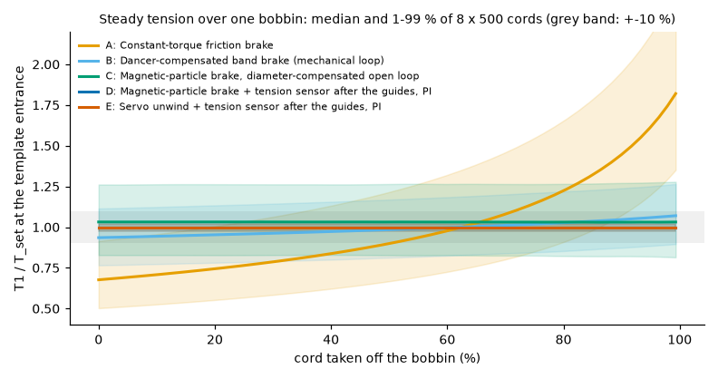
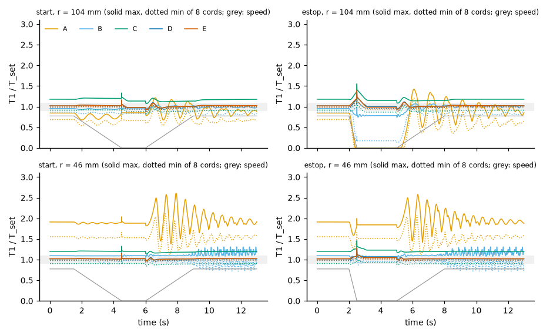
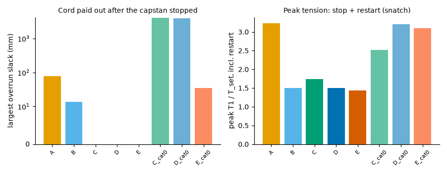
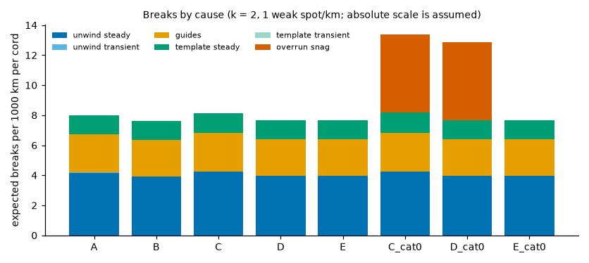
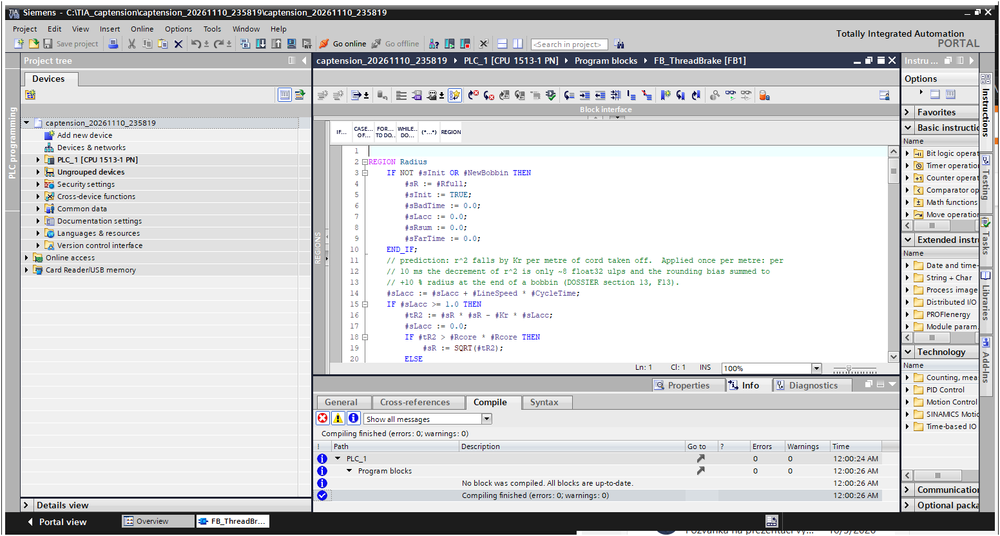

# cap-strip-thread-tension

This project analyses the **cord tension of a cap-strip line** in a tyre plant: eight nylon 6.6
tyre cords are unwound from bobbins, pulled through guides and a rubberising template, and the
strip is wound onto a spool. It compares five unwind-brake concepts, finds what drives thread
breaks, designs a direct tension measurement, and provides the PLC code: four Siemens **SCL**
blocks with OB30 that compile in **TIA Portal V18**. The work is laid out as a systems-engineering
dossier that follows Wasson's spine.

- **Read first:** [DOSSIER.md](DOSSIER.md) ([PDF](docs/DOSSIER.pdf)): need, ConOps, modes, requirements,
  architecture, interfaces, budgets, M&S, FMEA, trade study, V&V and line-trial plan.
- **Numbers:** [results/study.md](results/study.md) and [results/aoa.md](results/aoa.md).
- **Traceability:** [TRACEABILITY.md](TRACEABILITY.md).
- **Data:** everything here is **simulation**. No data from a real line, no PLCSIM run. Every
  parameter is tagged read / abstract / std / derived / assumed ([DOSSIER section 8.2](DOSSIER.md)).

**Question.** Which unwind-brake concept keeps the tension of all 8 cords within tolerance over a full
bobbin and through start, stop and emergency stop, and what drives thread breaks: the unwind, the
guides or the rubberising template?

**Alternatives.** A constant-torque friction brake; B dancer-compensated band brake; C
magnetic-particle brake with diameter compensation (open loop); D the same brake with a 3-roller
tension sensor after the last guide and a PI; E servo unwind with the same sensor.



## Findings

500 machines x 8 cords quasi-statically, 32 x 8 dynamically, the same machines and scenarios for every
alternative. Tolerance +-10 % of the recipe tension at the template entrance (assumed).

1. **Only measuring each cord after the guides keeps all 8 in tolerance over a full bobbin.**
   99th-percentile deviation in steady running: A 89.9 %, B 21.7 %, C 27.6 %, **D 2.5 %**, E 2.5 %;
   D with the sensor at the creel 13.7 %. Cord-to-cord pre-strain spread at embedding: B 1.15 %,
   **D 0.50 %**.
   - **Deciding parameters:** the radius ratio 2.75 for A; the guide-friction spread
     sigma(mu) x wrap = **6.4 % per position**, which no bobbin-side control sees, for B, C and D at the
     creel. Where the tension is measured matters more than the brake.
2. **Transients (worst machine, category-1 stop):** D starts within 0.85-1.11 x set and stops within
   0.93-1.20 x; the emergency stop with restart peaks at 1.50 x. A reaches 3.2 x. A speed-damping term
   in the brake law makes D work: without it no PI held +-10 % through a start (p99 13.2 % vs 7.0 %).

   

3. **The emergency-stop category matters more than the brake type.** If electric brakes lose power
   (category 0) the bobbins coast: **3.9-4.0 m of slack per cord** and 2.8-3.2 x set at the restart. With
   brakes powered to standstill (category 1): no slack.

   

4. **Breaks come from cord defects meeting the steady tension at the template exit, not from the
   brake concept.** Sound cord cannot break at 15-25 N; with weak spots (assumed 1 per km, strength tail
   exponent 2) the expected breaks per 1000 km per cord are A 8.02, B 7.64, C 8.16, **D 7.67**, E 7.66.
   - **Where:** 100 % between template and capstan.
   - **Share of that tension (D):** unwind 52 %, guides 31 %, template 17 %.
   - **Levers:** template drag halved **-16 %**, set tension -10 % **-16 %**, guides polished **0 %**
     for D (-1 % for A-C).
   - **Transients:** starts, stops and category-1 e-stops add < 0.1 %. Category-0 e-stops add +5.2 per
     1000 km (+68 %) through snagging slack loops (snag probability assumed).

   

5. **Direct measurement:** a 3-roller head after the last guide, calibrated in place, gives
   **0.19 N = 1.3 % of set (1 sigma)**; out of the box +-3.3 %. The model-based "virtual" tension from
   brake current and bobbin speed has a **23 % p99 static error**: a plausibility check, not a sensor.
6. **Cost and trade study:** 8 positions with engineering: A 1.2, B 5.8, C 15.2, **D 32.2**, E 47.2 kEUR
   (sensor and servo prices assumed). D does **not** pay back on breaks against B; it buys tension
   accuracy. Trade study: **D 70.6**, E 65.0, B 58.4, C 52.1, A 39.9; B wins once cost weighs 40 of 100.
7. **Winder:** the pull-off capstan decouples strip and cords while the recipe tension stays above
   **21.8 N** (capstan law). At 40 N the strip strain is 0.83 %; start and stop stay within 0.94-1.10 of
   the tapered reference.
8. **PLC fit:** all four SCL blocks, the DBs and OB30 at 10 ms compile in TIA Portal V18 (CPU 1513-1 PN)
   with **0 errors and 0 warnings**; worst cycle **0.58 ms**, **1.73 ms** with a 3x margin. float32 exposed
   a defect: the length-based radius prediction ended a bobbin at 44.08 mm instead of 40.00 mm; applied
   once per metre it ends at 40.003 mm.

   

**Recommendation.** Install the data collection (FB_DataCollect) on the existing creel first and
count breaks by phase and position; convert one position to D; run electric unwind brakes on a supply
that survives a category-1 stop; reduce breaks through the template drag, the set tension and the
cord's weak-spot density.

**What is not done:** PLCSIM (not installed on this PC), execution time on a real CPU, any line data.
The line-trial plan is in [DOSSIER section 11.3](DOSSIER.md).

## What is in the repo

| Path | Content |
|---|---|
| `src/captension/params.py` | Every parameter with its source tag (read / abstract / std / derived / assumed) and sensitivity range |
| `src/captension/bobbin.py` | Package radius from consumed length, inertia J(r), capacity |
| `src/captension/sim.py` | Eight cords through bobbin, guides, template and capstan: cord conservation, slack/snatch, brakes A-E, e-stop categories |
| `src/captension/control.py` | Python twins of FB_ThreadBrake and FB_WinderTension (vectorised) |
| `src/captension/breaks.py` | Weak-spot break model, material tracking (sparse-table range maximum), Euler attribution |
| `src/captension/winder.py` | Strip span, spool, recipe effects, capstan no-slip limit |
| `src/captension/sensor.py` | 3-roller sensor geometry and measurement-chain budget |
| `src/captension/scl.py` | Translator that runs the SCL in Python with float32 Real and counts operations |
| `plc/FB_*.scl` | `FB_ThreadBrake`, `FB_WinderTension`, `FB_LineSupervisor`, `FB_DataCollect` |
| `plc/tia/` | OB30 (10 ms), `LineIO` and instance DBs (generated by `scripts/gen_tia_sources.py`) |
| `scripts/run_study.py` | Whole study -> `results/study.md`, `results/summary.json`, `docs/img/` |
| `scripts/aoa.py` | Trade study -> `results/aoa.md` |
| `scripts/tia_*.ps1` | TIA Openness build, OB30 conversion, screenshot |
| `scripts/export_pdf.py` | DOSSIER.md -> docs/DOSSIER.pdf |

## Run it

```bash
pip install -e .[test]
python -m pytest -q                 # physics, models, SCL equivalence in float32 (about 3 min)
python scripts/run_study.py         # about 15 min on a laptop; --quick for a smoke run
python scripts/aoa.py
```

```powershell
powershell -ExecutionPolicy Bypass -File scripts\tia_build.ps1 -OutDir C:\TIA_captension
powershell -ExecutionPolicy Bypass -File scripts\tia_ob30.ps1  -Project <path.ap18>
powershell -ExecutionPolicy Bypass -File scripts\tia_screenshot.ps1 -Project <path.ap18> -Block FB_ThreadBrake -Out docs\img\tia_FB_ThreadBrake.png
```

## Licence

MIT, see [LICENSE](LICENSE).
